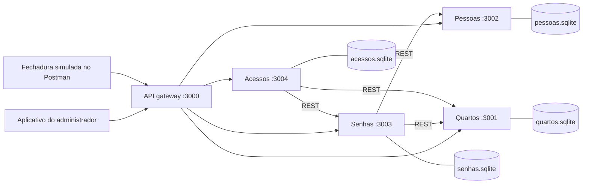

# API Acesso a Quartos

Backend para controle de acesso aos quartos, com quatro microservices e um API gateway. JavaScript com nomes em português, funções diretas e SQLite, mantendo a simplicidade dos projetos anteriores. Não há frontend nem dependência dos projetos anteriores.

## Como o código está organizado para estudar

As rotas do gateway estão escritas uma a uma. Os cadastros validam os campos e passam os valores para o SQL pelo nome. A decisão de acesso usa `if/else` e está dividida em cinco etapas comentadas. O arquivo `APRESENTACAO.md` mostra a ordem de leitura e relaciona cada requisito ao serviço responsável. As rotas, os bancos e as requisições do Postman continuam compatíveis com a versão anterior.

## Executar

Requisito: **Node.js 22.13 ou superior** e npm. O SQLite já vem no Node; não precisa instalar servidor de banco. Referências: [SQLite no Node](https://nodejs.org/download/release/latest-jod/docs/api/sqlite.html) e [roteamento Express](https://expressjs.com/en/guide/routing/).

Dentro desta pasta:

```bash
npm ci
cp .env.example .env
npm start
```

O comando inicia cinco processos. Aguarde aparecerem as cinco mensagens de API. Encerre com `Ctrl+C`. Os bancos são criados automaticamente em `dados/` e permanecem após reiniciar. `.env` e bancos não devem ser versionados. O `package-lock.json` fixa as dependências.

Gateway: `http://127.0.0.1:3000`. Para consultar a saúde: `GET /health` (indica apenas que aquele processo está disponível).

## Arquitetura



Cada microservice abre somente seu banco. IDs de outros serviços são referências lógicas, verificadas por HTTP com Axios. Não há JOIN entre bancos. O gateway apenas encaminha requisições, preserva os status HTTP e bloqueia rotas internas. Os processos usam `127.0.0.1` para a demonstração local.

## Testar no Postman

Importe `postman/atividade-3.postman_collection.json`. A coleção já define `baseUrl` e `adminToken`. Com os bancos vazios, execute as requisições na ordem ou use o Collection Runner. Os scripts guardam IDs e calculam datas relativas ao instante de execução, evitando exemplos vencidos. Há testes de status e decisão. A coleção usa identificadores aleatórios para permitir repetição.

Em cadastros e consultas, envie `Authorization: Bearer admin-local-123` (ou a chave definida no `.env`). A tentativa da fechadura não exige esse cabeçalho. Use `Content-Type: application/json` nas escritas.

| Método             | Rota                  | Finalidade                                |
| ------------------ | --------------------- | ----------------------------------------- |
| GET / POST         | `/quartos`            | Listar / cadastrar quartos                |
| GET / PUT / DELETE | `/quartos/:id`        | Consultar / substituir / desativar quarto |
| GET / POST         | `/pessoas`            | Listar / cadastrar pessoas                |
| GET / PUT / DELETE | `/pessoas/:id`        | Consultar / substituir / desativar pessoa |
| GET / POST         | `/senhas`             | Listar metadados / cadastrar senha        |
| GET / DELETE       | `/senhas/:id`         | Consultar metadados / revogar senha       |
| POST               | `/acessos`            | Tentar abrir a fechadura                  |
| GET                | `/acessos`            | Consultar últimas 1000 tentativas         |
| GET                | `/acessos?quartoId=1` | Últimas 1000 tentativas de um quarto      |

`PUT` exige todos os campos de cadastro. `ativo` é booleano opcional (padrão `true`); nas respostas de quartos e pessoas, o SQLite o representa como `1` ou `0`. `DELETE` faz exclusão lógica, preservando histórico. Para senhas, revogue e cadastre outra em vez de editar uma credencial já distribuída.

### Exemplo manual

1. `POST /quartos`:

```json
{ "nome": "Quarto 101", "fechaduraId": "FECH-101" }
```

2. `POST /pessoas`:

```json
{ "nome": "Ana Silva", "email": "ana@exemplo.com", "tipo": "hospede" }
```

Tipos: `hospede`, `limpeza` ou `manutencao`.

3. `POST /senhas` (substitua os IDs pelos retornados e ajuste as datas para incluir o horário da demonstração):

```json
{
  "quartoId": 1,
  "pessoaId": 1,
  "senha": "012345",
  "inicio": "2026-11-09T14:00:00-03:00",
  "fim": "2026-11-11T12:00:00-03:00"
}
```

Datas exigem fuso (`Z` ou `-03:00`). Início inclusivo, fim exclusivo; a decisão usa o relógio do servidor. O código é texto com 4 a 12 dígitos, preservando zeros à esquerda. Cada senha ativa deve ser diferente dentro de um mesmo quarto, evitando ambiguidade de pessoa. Uma pessoa pode ter senhas em vários quartos. Uma senha pode valer por vários dias.

4. `POST /acessos`:

```json
{ "fechaduraId": "FECH-101", "senha": "012345" }
```

Resposta durante a validade, com pessoa e quarto ativos:

```json
{
  "id": 1,
  "autorizado": true,
  "motivo": "acesso_autorizado",
  "dataHora": "2026-11-09T17:00:00.000Z"
}
```

A fechadura abre somente quando receber `autorizado: true`. Uma negativa normal retorna HTTP 200 com `autorizado: false`; 400 indica entrada inválida, 401 falta da chave administrativa, 404 recurso inexistente, 409 duplicidade e 503 dependência indisponível. Indisponibilidade nunca autoriza abertura.

## Regras e limites da atividade

- Senhas são armazenadas com salt aleatório e hash scrypt. Consultas e histórico nunca devolvem o código, hash ou salt. O aplicativo fornece o código no cadastro e pode compartilhá-lo com o hóspede. Não há envio real por e-mail/SMS, pois não foi configurado um provedor.
- O registro de acesso é gravado antes da autorização. Códigos incorretos, vencidos, futuros, malformados com fechadura identificável, fechaduras desconhecidas e falhas nas dependências são registrados. JSON ilegível ou requisição sem identificação da fechadura recebe 400, sem registro de tentativa identificável.
- Desativar pessoa ou quarto impede acessos por senhas existentes. Não há transação distribuída: uma alteração simultânea em outro serviço pode ocorrer entre a consulta e a decisão.
- A chave administrativa é uma autenticação simples para demonstração. Não representa contas individuais. As portas internas não possuem autenticação própria e não devem ser expostas. Integração com hardware, autenticação individual das fechaduras, HTTPS, limitação de tentativas e distribuição real de códigos ficam para uma implantação real.
- `/health` é local ao processo. Se o serviço de acessos estiver desligado, o gateway retorna 503 e não consegue registrar a tentativa; a fechadura deve manter a porta fechada. A aplicação não promete operação offline.
- `DATA_DIR` configura a pasta dos bancos; cada serviço continua com arquivo independente. As variáveis de portas permitem mudar as portas sem editar o código.

## Testes automatizados

```bash
npm test
```

Os testes sobem processos reais em portas temporárias e usam bancos temporários, sem alterar seus cadastros. Verificam isolamento dos bancos, persistência após reinício, cadastros, validações, hash, acesso permitido e negado, funcionários, revogação, desativação e falha de serviço. Não precisam de `npm start` em paralelo.

## Organização

- `src/gateway.js`: interface REST, chave administrativa e encaminhamento.
- `src/servicos/quartos.js`: cadastro e identificação das fechaduras.
- `src/servicos/pessoas.js`: hóspedes e funcionários.
- `src/servicos/senhas.js`: credenciais, validade, hash e verificação interna.
- `src/servicos/acessos.js`: decisão e histórico das tentativas.
- `src/comum.js`: funções de HTTP, validação, erros e abertura do banco de cada serviço.
- `scripts/iniciar.js`: inicialização e encerramento dos cinco processos.
- `testes/integracao.test.js`: testes pelo gateway.
- `APRESENTACAO.md`: roteiro e explicação do código.
